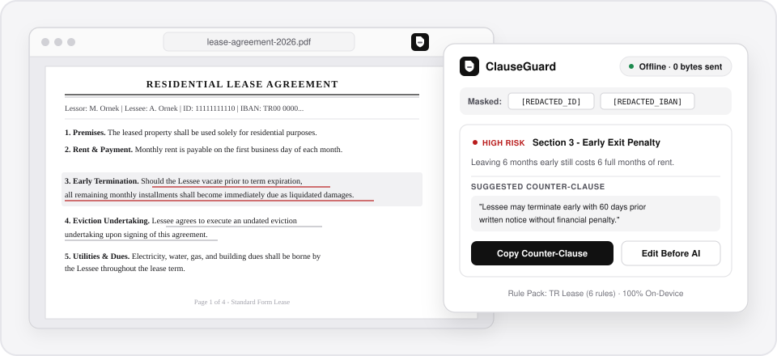
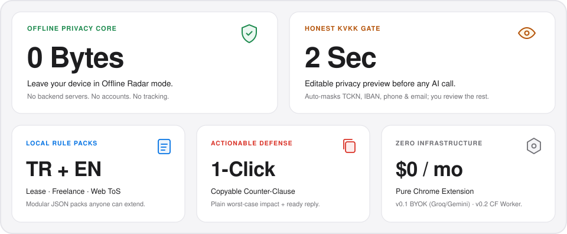
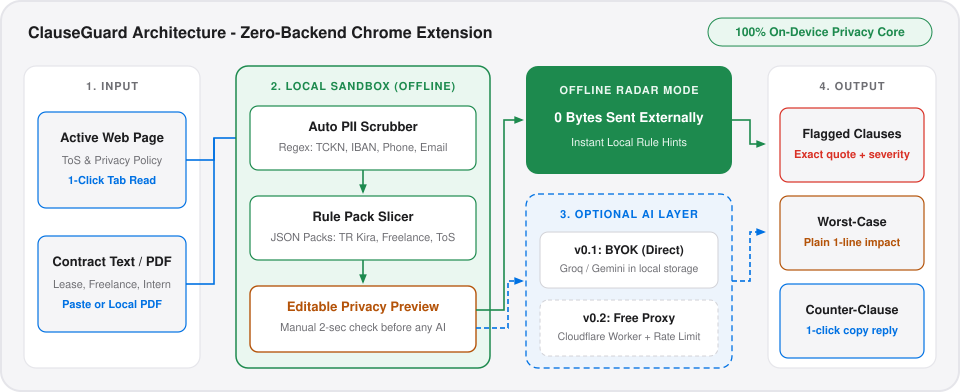
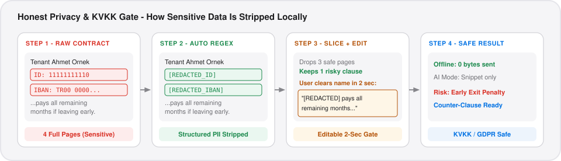

<p align="center">
  
</p>

<h1 align="center">ClauseGuard</h1>

<p align="center">
  <strong>See the trap. Keep your privacy.</strong><br/>
  A zero-backend Chrome extension that scans contracts and terms locally, masks PII, and lets you inspect exact snippets before optional AI explanation.
</p>

<p align="center">
  
</p>

---

## At a Glance



---

## Architecture



---

## Honest Privacy & KVKK Gate

Regex catches structured IDs automatically; an editable 2-second preview lets you strip any remaining names or addresses before optional AI analysis.



---

## Why ClauseGuard?

| Feature | ToS;DR | Generic AI Wrappers | ClauseGuard |
| :--- | :--- | :--- | :--- |
| **Input** | Popular sites only | Uploads full raw PDF | **Lease, Freelance, Intern + Web ToS** |
| **Privacy / KVKK** | Public pages only | Sends raw PII to LLM | **Local regex + Clause slicing + Editable gate** |
| **Offline Mode** | Static ratings | Requires AI | **100% offline suspicious-clause radar** |
| **AI Cost / Safety** | N/A | Server required | **v0.1 BYOK (Groq/Gemini) -> v0.2 Free Cloudflare Worker** |
| **Output** | Passive grade | Passive summary | **Worst-case impact + 1-click counter-clause** |

---

## Planned Structure

```text
clauseguard/
├── docs/                   # Logo, promo visuals & architecture schematics
├── extension/              # Load unpacked in chrome://extensions (Manifest V3)
│   ├── manifest.json       # Extension config
│   ├── popup.html / .js    # Compact UI + editable privacy preview
│   ├── scrubber.js         # Local PII regex masker
│   ├── matcher.js          # Offline rule matcher & clause slicer
│   └── rules/              # Modular JSON packs (tr-kira, freelance, web-tos)
└── tests/                  # Synthetic sample contracts (zero real PII)
```

---

## Roadmap

### Phase 1: Foundation & Rule Packs
- [x] Initialize repository, MIT license, and `.gitignore`
- [x] Create brand logo, promotional visuals, and schematic `README.md`
- [ ] Build Chrome Manifest V3 skeleton (`extension/manifest.json`, `popup.html`, `popup.css`, `popup.js`)
- [ ] Author JSON Rule Packs (`tr-kira.json`, `freelance.json`, `web-tos.json`) and synthetic test contract

### Phase 2: Local Privacy & Offline Radar
- [ ] Implement `extension/scrubber.js` (auto-mask TCKN, IBAN, phone, email)
- [ ] Implement `extension/matcher.js` (sentence slicer + Turkish-aware rule matching)
- [ ] Wire `Scan Locally` and editable privacy preview in `popup.js`

### Phase 3: Optional AI Explainer (Groq / Gemini)
- [ ] Add local API key settings (`chrome.storage.local` - BYOK, never committed to repo)
- [ ] Send only approved anonymous snippets to Groq/Gemini for worst-case impact and counter-clause

### Phase 4: Shared Free Tier (v0.2)
- [ ] Add client-side text-PDF reader (`pdf.js`) with scanned-PDF warning
- [ ] Add rate-limited Cloudflare Worker proxy (`worker/`) holding the free-tier Groq secret safely

---

> **Disclaimer:** ClauseGuard is an informational decision-support tool and does not provide legal advice.
