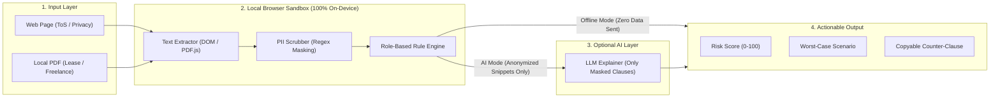
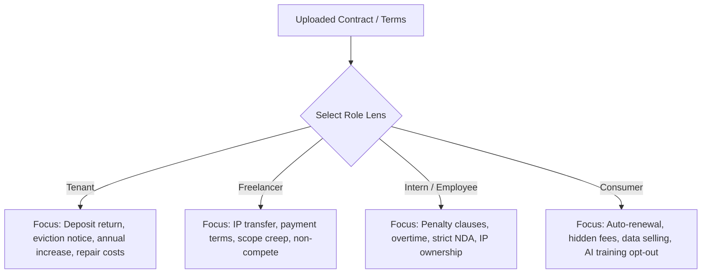

# ClauseGuard

> **Privacy-First Contract & Terms Risk Filter** - Scan web terms or PDF agreements (lease, freelance, internship) through your personal role lens without exposing private data to AI models.

---

## 1. How It Works (Architecture Schematic)

ClauseGuard runs as a **compact browser extension** (with an optional lightweight backend). Personal data never leaves your device:



---

## 2. Privacy & KVKK / GDPR Protection Flow

Traditional AI wrappers upload your entire contract (including names, ID numbers, addresses, and signatures) to external LLM servers. ClauseGuard strips personal identifiers locally and sends **only isolated legal clauses**:

```text
[Raw Lease PDF]
"Tenant Ahmet Yilmaz (ID: 12345678901, IBAN: TR12...) agrees to pay all remaining months if vacating early."
       |
       v  1. Local PII Scrubber (In-Browser Regex)
"Tenant [REDACTED_NAME] (ID: [REDACTED_ID], IBAN: [REDACTED_IBAN]) agrees to pay all remaining months if vacating early."
       |
       v  2. Clause Slicer (Drops harmless boilerplate, keeps only risky sentence)
"Tenant [REDACTED] agrees to pay all remaining months if vacating early."
       |
       v  3. Optional AI Explanation (Or 100% Local Rule Match)
[Output Card]
- Risk: High (Early Termination Penalty)
- Worst Case: You pay the full annual rent even if you move out early.
- Counter-Clause: "Tenant may terminate with 30 days prior written notice without penalty."
```

---

## 3. How ClauseGuard Differs from Existing Tools

| Feature | ToS;DR | Generic AI Summarizers | Enterprise Legal AI | ClauseGuard |
| :--- | :--- | :--- | :--- | :--- |
| **Input Type** | Popular websites only | Raw PDF or text | B2B contracts | **Web Pages + Local PDFs** |
| **Privacy / KVKK** | Public pages only | Sends full raw document to LLM | Cloud NDA required | **Local PII masking + Clause slicing** |
| **Offline / No-AI Mode** | Static database | No | No | **Yes (Local rule engine works without AI)** |
| **Scoring Logic** | Fixed A-E grade for everyone | Generic summary | Corporate playbooks | **Role Lens (Tenant, Freelancer, Intern, Consumer)** |
| **Actionability** | Passive warnings | Passive summary | Legal redlining | **1-click copyable counter-clause** |

---

## 4. Role Lens Matrix

The same contract is scored differently depending on the active profile:



---

## 5. Project Structure

```text
clauseguard/
├── extension/          # Compact Chrome Extension (Manifest V3)
│   ├── manifest.json   # Extension permissions (activeTab, sidePanel)
│   ├── popup.html      # Compact UI (Role selector, Web scan, PDF dropzone)
│   ├── popup.js        # UI controller & transparency preview
│   ├── scrubber.js     # Local PII masking (ID, IBAN, phone, email, address)
│   └── matcher.js      # Local rule engine (works 100% offline)
├── backend/            # Optional lightweight FastAPI proxy for AI explanations
│   ├── main.py         # POST /analyze (accepts only masked clause snippets)
│   └── analyzer.py     # Structured JSON prompt for worst-case & counter-clause
├── rules/
│   └── profiles.json   # Role weights & regex/keyword patterns per risk category
└── tests/              # Synthetic sample contracts (lease, freelance, ToS)
```

---

## 6. Roadmap & TODO Checklist (v0.1 MVP)

### Phase 1: Foundation & Rules
- [x] Initialize GitHub repository, MIT license, and `.gitignore`
- [x] Create visual `README.md` with architecture schematics
- [ ] Create directory skeleton (`extension/`, `backend/`, `rules/`, `tests/`)
- [ ] Define role profiles (`tenant`, `freelancer`, `intern`, `consumer`) and keyword patterns in `rules/profiles.json`

### Phase 2: Local Privacy & Rule Engine (No-AI Core)
- [ ] Build `extension/scrubber.js` to mask IDs, IBANs, phones, emails, and amounts locally
- [ ] Build `extension/matcher.js` to detect risky clauses offline using `rules/profiles.json`
- [ ] Add PDF text extraction in the browser (or lightweight parser)

### Phase 3: Compact Extension UI
- [ ] Build `extension/manifest.json` and `extension/popup.html` (Web Scan tab + PDF Drop tab)
- [ ] Add **"Inspect Masked Text"** preview so users see exactly what is redacted before any AI call
- [ ] Render Risk Score (0-100) and flagged clause cards

### Phase 4: Optional AI Explainer
- [ ] Add optional AI explanation mode (sends only masked, flagged clauses to generate plain summaries and counter-clauses)
- [ ] Support **BYOK (Bring Your Own Key)** or lightweight `backend/` proxy

### Phase 5: Testing
- [ ] Add synthetic lease and freelance contracts to `tests/`
- [ ] Verify zero-PII leakage on test documents

---

## 7. Shared JSON Output Schema

```json
{
  "overall_score": 74,
  "active_profile": "tenant",
  "mode": "hybrid_ai",
  "masked_pii_count": 4,
  "flagged_clauses": [
    {
      "category": "early_termination_penalty",
      "severity": "high",
      "original_quote": "Tenant [REDACTED_NAME] agrees to pay all remaining months if vacating early.",
      "plain_summary": "Moving out before the lease ends forces you to pay rent for all remaining months.",
      "worst_case_scenario": "Leaving 6 months early still costs you 6 full months of rent.",
      "suggested_counter_clause": "Either party may terminate the lease early by providing 60 days prior written notice."
    }
  ]
}
```

---

## 8. Disclaimer

ClauseGuard does not provide legal advice. It is an informational decision-support tool designed to help users review contract clauses more efficiently.
